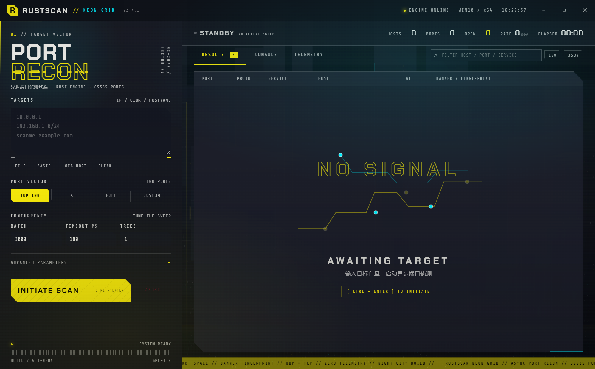
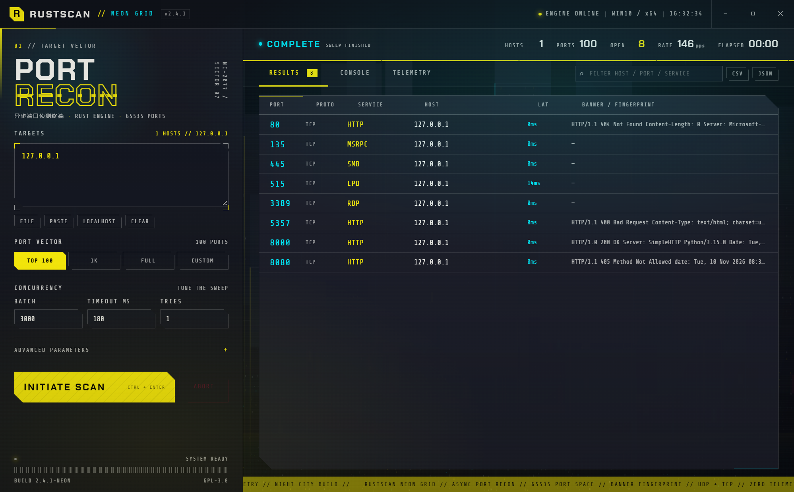
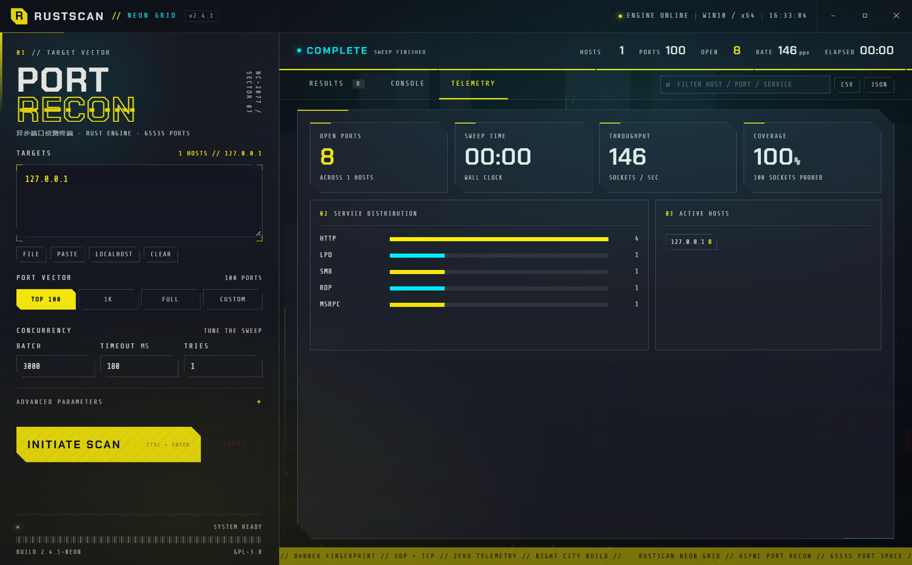

# RustScan for Windows

Native Windows desktop client for **[RustScan](https://github.com/bee-san/RustScan)** — the fast asynchronous port scanner.

Tauri 2 · WebView2 · single portable `.exe` · Windows 10/11 x64

[**Download the latest release**](https://github.com/badarch47/rustscan-for-windows/releases/latest)



## Overview

RustScan for Windows puts the RustScan 2.4.1 scanning engine behind a native desktop UI. The engine is linked directly as a Rust library from `engine/` — there is no `rustscan.exe` sidecar, no CLI spawning, and no stdout parsing. Targets, ports, scan parameters, live results, banners, and exports all live in one borderless window.

The interface is English. The scanner is RustScan; this project is the Windows client around it.

## Features

- **Targets** — single IP, CIDR, hostname, last-octet range (`192.168.1.10-20`), file import, clipboard paste, automatic deduplication and DNS resolution.
- **Port presets** — TOP 100, 1–1000, 1–65535, and custom specs such as `1-1024,3306,8000-8100`.
- **Scan controls** — batch size, timeout, retries, excluded ports, random/serial order, inter-packet interval, max hosts, UDP mode, banner grabbing.
- **Live telemetry** — hosts, ports, open sockets, rate, elapsed time, progress bar, service distribution, active-host summary.
- **Banner / service identification** — SSH, HTTP, HTTPS, FTP, SMTP, Redis, MySQL, PostgreSQL, MongoDB, SMB, RDP, VNC, and more, with a port-table fallback.
- **Results table** — sort by port, service, host, or latency; filter by keyword; click a row to copy `host:port`.
- **Export** — CSV and JSON through the native save dialog.
- **Abort** — cancel an in-flight sweep and keep everything already discovered.
- **Native shell** — custom title bar, procedural neon skyline, scanlines, acid-yellow/cyan/red palette, 1440×900 default window, 1120×700 minimum.
- **Portable** — one exe, frontend assets embedded, no installer and no background service.

## Download

Grab the latest build from **[Releases](https://github.com/badarch47/rustscan-for-windows/releases/latest)**:

```text
RustScan-for-Windows-2.4.1-win64.zip
```

Unzip anywhere and run `RustScanNeon.exe`. Windows 10/11 ships with the WebView2 Runtime through Edge; if it is missing, install the [Evergreen WebView2 Runtime](https://developer.microsoft.com/microsoft-edge/webview2/).

## Screenshots





## Quick start

1. Enter a target, for example `127.0.0.1`.
2. Pick `TOP 100` and keep `BANNER GRAB` enabled.
3. Click `INITIATE SCAN`.
4. The status moves through `RESOLVING` → `SWEEPING` → `COMPLETE`. Open ports appear in the table as they are found.
5. Click `CSV` or `JSON` to export through the native save dialog.

Keyboard shortcuts:

| Key | Action |
|---|---|
| `Ctrl + Enter` | Start scan |
| `Esc` | Abort scan |
| `Ctrl + K` | Focus the result filter |

## Build from source

Requirements:

- Windows 10 1809+ or Windows 11, x64
- [Rust](https://rustup.rs/) stable, `x86_64-pc-windows-msvc`
- Visual Studio 2022 Build Tools with **Desktop development with C++** and a Windows 10/11 SDK
- WebView2 Runtime (normally already installed)

Install the toolchain:

```powershell
winget install --id Microsoft.VisualStudio.2022.BuildTools --override "--quiet --wait --norestart --add Microsoft.VisualStudio.Workload.VCTools --includeRecommended"
rustup default stable-x86_64-pc-windows-msvc
```

Build:

```powershell
git clone https://github.com/badarch47/rustscan-for-windows.git
cd rustscan-for-windows
powershell -ExecutionPolicy Bypass -File scripts\build.ps1
```

The script imports `VsDevCmd.bat -arch=x64`, runs:

```powershell
cargo build --release -j 2 --manifest-path src-tauri\Cargo.toml
```

and produces:

```text
src-tauri\target\release\rustscan-neon.exe
dist\RustScanNeon\RustScanNeon.exe
dist\rustscan-neon-2.4.1-win64.zip
```

Run the freshly built binary:

```powershell
powershell -ExecutionPolicy Bypass -File scripts\run.ps1
```

## Tests

```powershell
powershell -ExecutionPolicy Bypass -File scripts\test.ps1
```

Expected:

```text
running 5 tests
test scan::tests::scan_id_has_prefix ... ok
test targets::tests::top_list_has_expected_size ... ok
test services::tests::known_services ... ok
test targets::tests::port_spec_dedupes_and_validates ... ok
test services::tests::banner_is_sanitized ... ok
test result: ok. 5 passed; 0 failed
```

## How it works

- `src-tauri/src/scan.rs` calls `rustscan::scanner::Scanner::new(...).run_with_status()` directly. No process boundary, no CLI output parser.
- Work is split into chunks of roughly 20,000 sockets (port count per chunk clamped to 16–4096 based on host count). Every finished chunk emits `scan://progress`.
- Cancellation combines a `tokio::sync::watch` channel with `tokio::select!`; unfinished sockets are dropped and banner-probe tasks are aborted. Results already emitted stay in the UI buffer.
- Banner probing reuses the scan timeout (120 ms floor). Server-first protocols are read directly; HTTP gets a `HEAD`; TLS ports are read-only; output is capped at 160 characters and binary bytes become `.`.
- `hosts × ports` is capped at 8,000,000 before a scan starts, so a mistyped `0.0.0.0/0` cannot exhaust the machine.
- No nmap dependency. Service identification is local and offline; extend `src/services.rs` if you want nmap-style version probes.

## Scan parameters

| Parameter | Default | Range / notes |
|---|---|---|
| Batch size | 3000 | 1–20000 concurrent sockets per chunk |
| Timeout | 180 ms | 10–10000 ms per connection |
| Retries | 1 | 1–10 |
| Excluded ports | empty | e.g. `9100,9200-9300` |
| Order | random | random or serial |
| Interval | 0 ms | 0–60000 ms between packets |
| Max hosts | 1024 | 1–4096 |
| UDP | off | UDP probe mode |
| Banner grab | on | one lightweight fingerprint pass on open TCP ports |

Tauri commands used by the UI: `start_scan`, `cancel_scan`, `preview_targets`, `pick_target_file`, `save_export`, `window_control`, `env_info`.

## Repository layout

```text
.
├─ engine/                    RustScan 2.4.1 source (upstream, GPL-3.0)
├─ src-tauri/
│  ├─ src/main.rs             Tauri entry, dialogs, window commands
│  ├─ src/scan.rs             scan orchestration, chunking, events, cancellation
│  ├─ src/targets.rs          target/CIDR/port parsing, TOP 100
│  ├─ src/services.rs         service table, banner probe and normalization
│  ├─ Cargo.toml              rustscan = { path = "../engine" }
│  ├─ Cargo.lock
│  ├─ tauri.conf.json         borderless 1440×900 window, frontendDist ../ui
│  └─ icons/
├─ ui/
│  ├─ index.html              single-page interface
│  ├─ css/neon.css            cyberpunk visual system, self-hosted fonts
│  ├─ js/app.js               state machine, table, exports, demo mode
│  ├─ js/bridge.js            Tauri invoke/listen wrapper
│  ├─ js/city.js              procedural skyline canvas
│  └─ assets/fonts/           Chakra Petch, Rajdhani, Share Tech Mono (OFL)
├─ scripts/
│  ├─ build.ps1               release build + dist + zip
│  ├─ test.ps1                cargo test with MSVC environment
│  ├─ run.ps1                 launch the built exe
│  ├─ run-debug.cmd           launch with CDP on port 9222
│  ├─ shot.cjs                browser/CDP screenshots
│  ├─ shot-native.cjs         native WebView2 screenshots
│  ├─ eval.cjs                browser runtime evaluation
│  ├─ eval-native.cjs         native runtime evaluation
│  └─ probe-layout.cjs        layout probe
├─ docs/screenshots/
├─ LICENSE                    GPL-3.0 (RustScan upstream text)
├─ package.json
└─ README.md
```

## Credits & acknowledgements

**This project is the desktop client. The scanner is [RustScan](https://github.com/bee-san/RustScan).**

Sincere thanks to **[bee-san](https://github.com/bee-san)** and every RustScan contributor. `engine/` is RustScan v2.4.1, vendored under GPL-3.0; the only change to the vendor copy is removing a stale `.gitmodules` entry. All credit for the scanning engine, its design, and its performance belongs to the RustScan authors. If this client is useful to you, please star the upstream repository and support its maintainers.

Additional thanks:

- [Tauri](https://tauri.app/) for the desktop shell and bundler.
- [Microsoft Edge WebView2](https://developer.microsoft.com/microsoft-edge/webview2/) for the rendering runtime.
- Chakra Petch, Rajdhani, Share Tech Mono, and a Smiley Sans (得意黑) display subset, released under the SIL Open Font License 1.1. Font notices are in `ui/assets/fonts/LICENSES.md` and `ui/assets/fonts/licenses/`.

## License

GPL-3.0-only. The RustScan engine in `engine/` is licensed under GPL-3.0; the upstream license text is kept in `LICENSE` and `engine/LICENSE`. Fonts are SIL OFL 1.1.

---

## 中文说明

RustScan for Windows 是 **RustScan 2.4.1** 的 Windows 原生桌面客户端。扫描内核以 Rust 库的形式直接链接 `engine/`，不调用外部 `rustscan.exe`，也不解析命令行输出。界面为英文，单 exe 便携运行。

### 致谢 RustScan

特别感谢 **[bee-san](https://github.com/bee-san)** 与 **[RustScan](https://github.com/bee-san/RustScan)** 的全体贡献者。本项目的扫描能力完全来自 RustScan；`engine/` 为 RustScan v2.4.1 源码，按 GPL-3.0 使用，除删除一个失效的 `.gitmodules` 条目外未做修改。扫描引擎的设计与性能归功于 RustScan 作者与社区。

### 下载与构建

下载：[Releases](https://github.com/badarch47/rustscan-for-windows/releases/latest) 中的 `RustScan-for-Windows-2.4.1-win64.zip`，解压后运行 `RustScanNeon.exe`。

```powershell
powershell -ExecutionPolicy Bypass -File scripts\build.ps1
powershell -ExecutionPolicy Bypass -File scripts\test.ps1
powershell -ExecutionPolicy Bypass -File scripts\run.ps1
```

快捷键：`Ctrl+Enter` 开始扫描，`Esc` 终止，`Ctrl+K` 聚焦结果过滤框。
